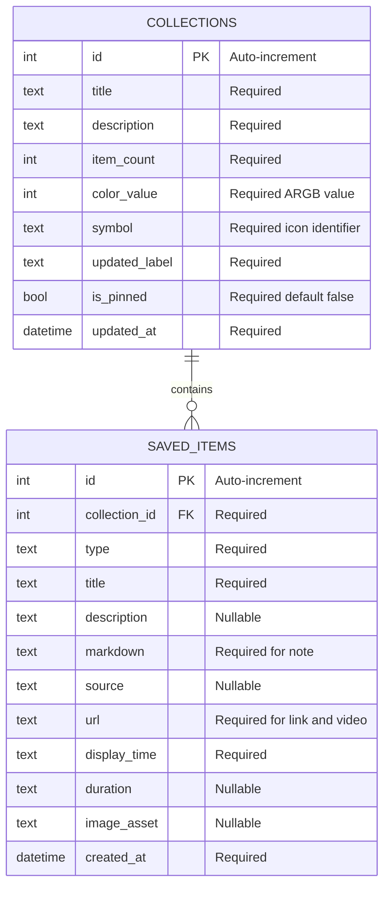

# AppDatabase schema

`AppDatabase` is a Drift database backed by SQLite. The current schema version
is `5` and contains two related tables.

[Open the simple HTML diagram](database.html)

## Table behavior

### `saved_items`

Stores the content shown in the Library. Every item belongs to one collection
through the required `collection_id` foreign key. `watchRecentItems()` exposes
a reactive stream ordered by `createdAt DESC`, so the newest item appears first.

The `type` value identifies the presentation used by the app:

- `note` — requires `markdown`
- `link` — requires `url`
- `video` — requires `url`

The database enforces that `url` is present whenever `type` is `link` or
`video`. It also enforces that `markdown` is present whenever `type` is `note`.
Notes may store `url` as `NULL`, while links and videos may store `markdown` as
`NULL`.

### `collections`

Stores collection metadata. `watchCollections()` exposes a reactive stream
ordered by `isPinned DESC` and then `updatedAt DESC`, keeping pinned collections
first and the most recently updated entries next.

## Relationships

`collections` has a one-to-many relationship with `saved_items`. A collection
can contain zero or more items, while each saved item must reference exactly one
collection through `saved_items.collection_id`.

`Collections.itemCount` remains stored summary data rather than a live SQL
count derived from the relationship.

## Migration history

- Schema version `1`: `saved_items`
- Schema version `2`: adds `collections`
- Schema version `3`: adds the required `saved_items.collection_id` foreign key;
  existing items are assigned to an `Uncategorized` collection
- Schema version `4`: adds `saved_items.url`; legacy links and videos receive a
  reserved migration URL when their original URL is unavailable
- Schema version `5`: adds `saved_items.markdown`; legacy notes use their
  existing description or title as valid plain-text Markdown

The source of truth is
[`lib/core/database/`](../lib/core/database/). See its
[module README](../lib/core/database/README.md) for file responsibilities and
the schema-change workflow.
